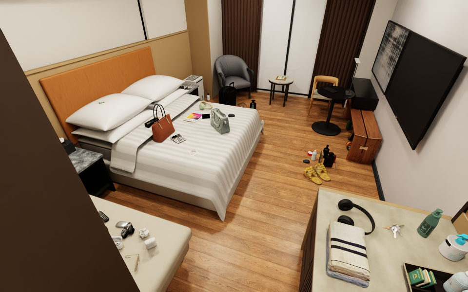
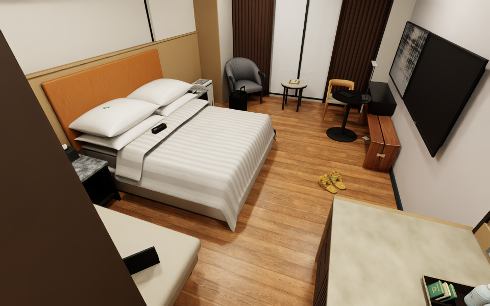
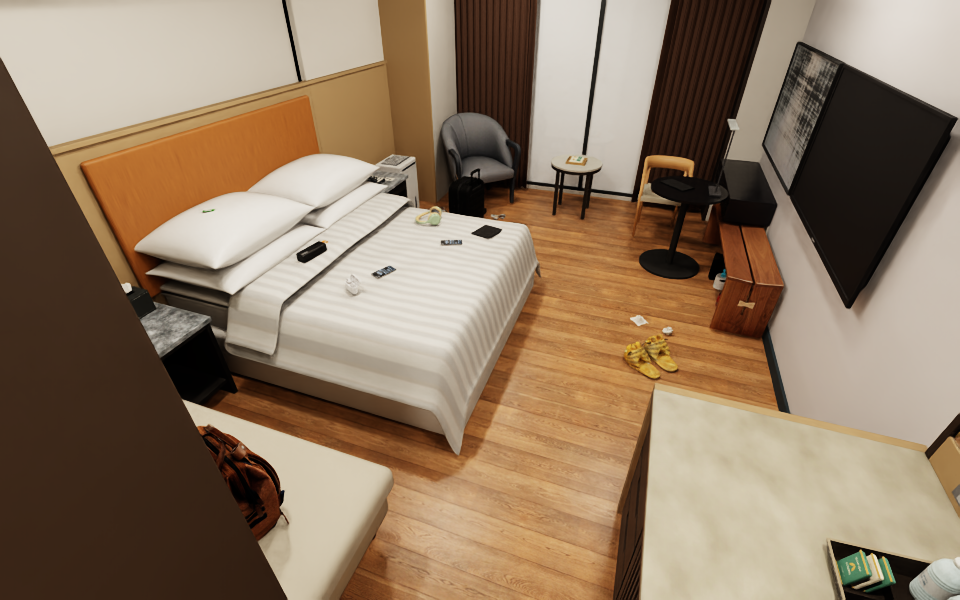
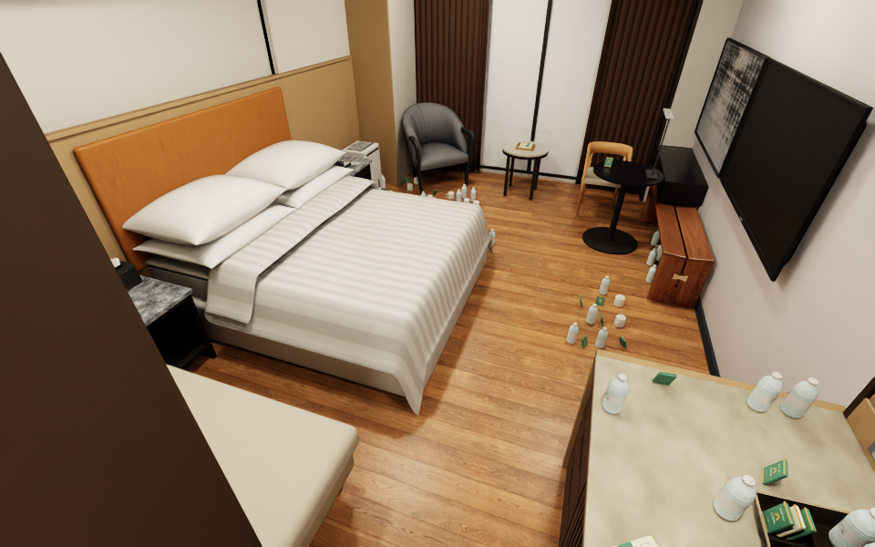
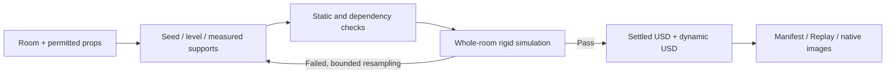

# Hotel Room Clutter Generator

**English** | [繁體中文](README.zh-TW.md)

Seeded hotel guest clutter, measured placement surfaces, full-room rigid simulation and portable USD examples. Research progress for **19 November 2026**.

**Randomization scope: guest clutter only.** The original bed, desk, cabinet and chair layout is retained. Simulation of authored room bodies/joints is separate from furniture-layout randomization, which is not implemented here.



The image shows the **local research pool**. The downloadable examples use the original Hotel705 props with confirmed room redistribution permission; their smaller prop pool is shown separately below. Blendkit models are not included in the download.

| Low | Medium | High |
| --- | --- | --- |
|  |  |  |

## Current results

- **102 independently counted Blendkit assets locally accepted**, plus 3 appearance variants counted separately. Conversion, actual Isaac images, visual review, Static/Integrity/Native Support/Replay are checked; downloads and instances are not usable-asset counts.
- Two seeds (**706 / 707**) × three density ranges: **Low 10–20**, **Medium 30–50**, **High 70–80** object instances.
- Every delivered scene has an actual **30 s / 120 Hz / 3,600-step CPU PhysX** room test, including the original room bodies and joints. Final-two-second stability, displacement, support-region retention, dependencies and effective-pose replay are checked for these exact cases.
- Soft-body deformation is deferred. Fixed-form geometry and approximate rigid proxies do not qualify cloth manipulation, calibrated masses or arbitrary future seeds.

## Download ready-to-open rooms

[**Download clean room + six example scenes**](https://github.com/FrankChen0930/hotel-room-clutter-generator/raw/refs/heads/main/downloads/hotel705_examples.zip) · [Package checksums](docs/PACKAGE_STATUS.json)

Extract the complete ZIP and keep its `assets/` folder. Open `clean_room.usda` for the unmodified room arrangement, or choose a scene below. Normal scenes retain the settled generated poses; `_dynamic.usda` variants activate the tested rigid setup. An isolated USD file without its dependencies is insufficient.



**Public examples use five original-room prop records with limited diversity and repeated instances.** They are independent from the expanded Blendkit research pool and do not increase its asset count. Source/permission and exact package mappings are recorded in the archive.

| Seed | Level | Instances | Room physics | Preview | Path inside ZIP |
| --- | --- | ---: | --- | --- | --- |
| 706 | Low | 15 | PASS | [Preview](docs/previews/public-low706.png) | `scenes/low_seed_706.usda` |
| 706 | Medium | 32 | PASS | [Preview](docs/previews/public-medium706.png) | `scenes/medium_seed_706.usda` |
| 706 | High | 77 | PASS | [Preview](docs/previews/public-high706.png) | `scenes/high_seed_706.usda` |
| 707 | Low | 13 | PASS | [Preview](docs/previews/public-low707.png) | `scenes/low_seed_707.usda` |
| 707 | Medium | 49 | PASS | [Preview](docs/previews/public-medium707.png) | `scenes/medium_seed_707.usda` |
| 707 | High | 73 | PASS | [Preview](docs/previews/public-high707.png) | `scenes/high_seed_707.usda` |

## Reproduce room → generation → physics → USD

The repository includes permission-audited room/native input data and a separate public runtime under `research/`. The existing `toolkit/` is retained.

Tested on Windows, Isaac Sim **6.0.0-rc.59**, its bundled Python and an RTX5070Ti Laptop GPU. Rendering uses Direct3D12; dynamics use CPU PhysX. Other SDK versions are not certified. Use the bundled Isaac Python; change its executable path for your installation.

```powershell
& "C:\isaac_sim\kit\python\python.exe" -B research\_asset_library_blendkit\scripts\run_public_workflow.py --tag my_hotel705_run --seeds 706 707
```

This samples both seeds and all levels, runs bounded simulation feedback, exports settled/dynamic USD, verifies scoped source hashes/physics/Replay/dependencies, and captures actual images. Results go to new directories under `research/_asset_library_blendkit/runs/`. Use a fresh tag each time. No Blendkit login, subscription or model-download API is used by this public example workflow.



## Asset and rights scopes

`docs/asset_sources.json` records original Blendkit IDs, authors, source URLs, versions, source SHA and separate rights gates. Free acquisition or local technical acceptance does not clear extractable-USD redistribution. Blendkit GENERATION_READY/public Starter remain 0/0; these counts do not describe the separately permitted original-room examples.

Hotel705 room/native redistribution permission was confirmed by the project maintainer on18November2026. No blanket license is assigned to third-party material. See [rights](RIGHTS.md), [license status](LICENSE_STATUS.md) and [delivery scope](docs/DELIVERY_SCOPE.md). The original room attribution is retained. Raw Blendkit models, textures, add-on, profiles, credentials, SDK and paper PDFs are excluded.

This is research evidence for the included cases, not a robot-safety or universal dynamics certificate.

## Progress presentation

[19 November research report (editable PowerPoint)](reports/2026-11-19/hotel_room_weekly_20261119_editable.pptx)
