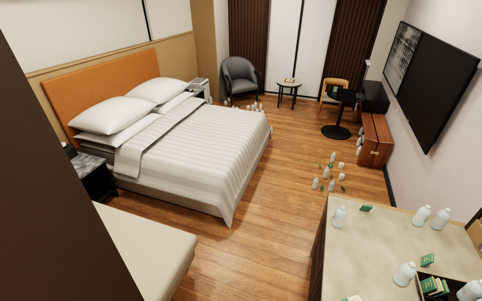
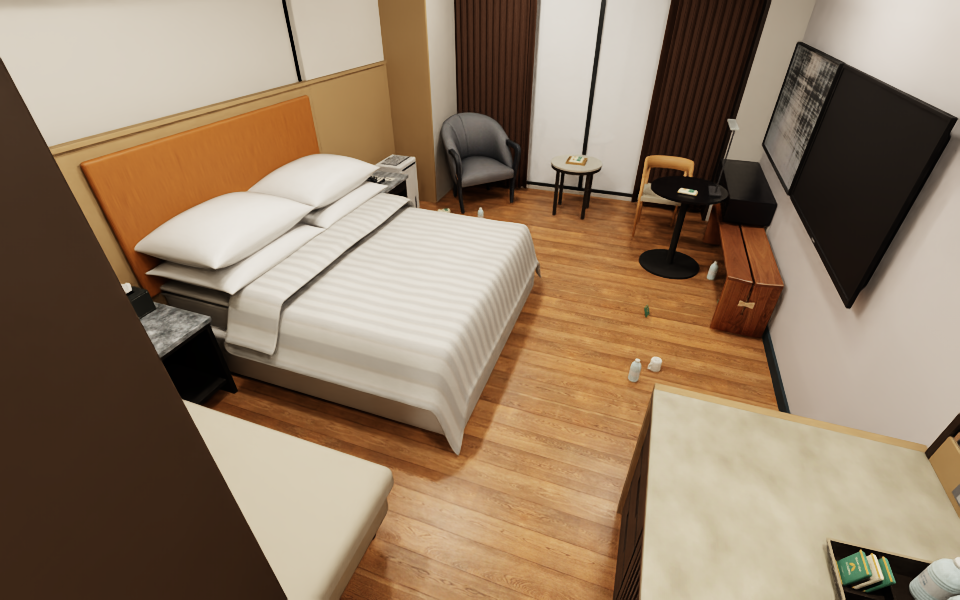
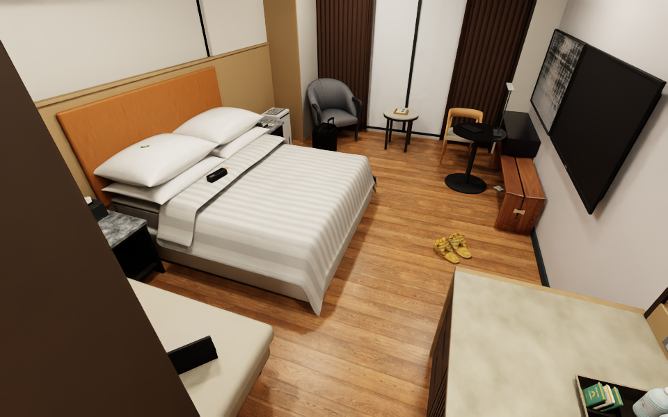
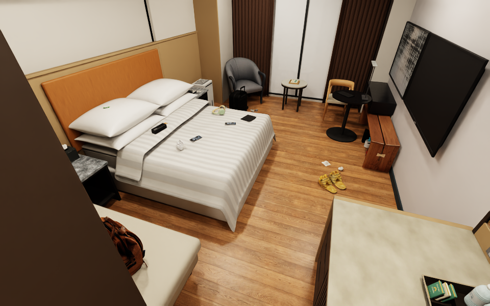
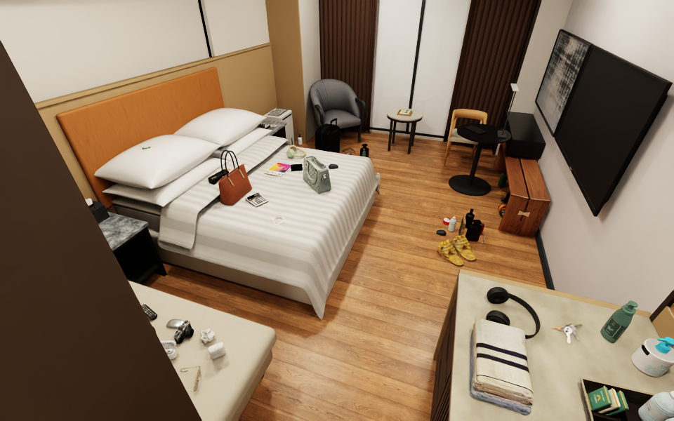

# Hotel Room Clutter Generator

[English](README.md) | **繁體中文**

以 Seed 生成飯店住客雜物，結合實測擺放區域、全房間剛體模擬與可攜式 USD。**2026/11/19 研究進度**。

**目前隨機化的是住客雜物，主要家具配置固定。** 床、桌、櫃、椅保留原始布局；原場景剛體／關節參與模擬，不代表已實作家具重新配置。



上圖與下方六組圖，都是**實際可下載的場景**：完整 Hotel705 房間、原有家具，以及五個原房間道具來源。**不含 Blendkit 模型**，因此會有較多重複物件。102 種資產的本機研究預覽另列於本頁下方。

| Seed | Low | Medium | High |
| --- | --- | --- | --- |
| 706 |  |  |  |
| 707 |  |  |  |

## 目前成果

- **102 種獨立 Blendkit 資產通過本機驗收**，另有 3 個外觀變體分開記錄。完成轉換、Isaac 實際影像、視覺審查及 Static／Integrity／Native Support／Replay；下載數、場景實例數不當作可用資產數。
- Seed **706／707**，各三種密度：**Low 10–20、Medium 30–50、High 70–80** 個物件實例。
- 每個交付場景均實際執行 **30 秒、120 Hz、3,600 步 CPU PhysX 全房間測試**，包含原始房間剛體與關節；檢查最後兩秒穩定性、位移、支撐區域、依賴與有效姿態 Replay。
- 柔性形變暫緩。固定外形與剛體代理不代表布料操作、真實質量校準或任意未來 Seed 已驗證。

## 直接下載房間

[**下載 clean room 與六組範例場景**](https://github.com/FrankChen0930/hotel-room-clutter-generator/raw/refs/heads/main/downloads/hotel705_examples.zip) · [封裝校驗資訊](docs/PACKAGE_STATUS.json)

完整解壓縮並保留 `assets/`，開啟 `clean_room.usda`，或選擇下列場景。一般版保留模擬後的生成物件姿態；`_dynamic.usda` 啟用已測試的剛體設定。僅拿走單一 USD 而省略依賴檔案，無法完整載入。


**公開範例使用五個原房間道具紀錄，種類有限且含重複實例**；與擴充 Blendkit 研究池分開，不增加資產庫的獨立數量。原始來源、同意紀錄、封裝檔案對照均保留於下載包。

| Seed | 程度 | 實例數 | 全房間物理 | Preview | ZIP 內路徑 |
| --- | --- | ---: | --- | --- | --- |
| 706 | Low | 15 | PASS | [Preview](docs/previews/public-low706.png) | `scenes/low_seed_706.usda` |
| 706 | Medium | 32 | PASS | [Preview](docs/previews/public-medium706.png) | `scenes/medium_seed_706.usda` |
| 706 | High | 77 | PASS | [Preview](docs/previews/public-high706.png) | `scenes/high_seed_706.usda` |
| 707 | Low | 13 | PASS | [Preview](docs/previews/public-low707.png) | `scenes/low_seed_707.usda` |
| 707 | Medium | 49 | PASS | [Preview](docs/previews/public-medium707.png) | `scenes/medium_seed_707.usda` |
| 707 | High | 73 | PASS | [Preview](docs/previews/public-high707.png) | `scenes/high_seed_707.usda` |

## 重現：房間 → 生成 → 物理 → USD

`research/` 提供經權利範圍檢查的房間／原生道具輸入和獨立執行環境；既有 `toolkit/` 保留。

實測環境：Windows、Isaac Sim **6.0.0-rc.59**、其內建 Python、RTX5070Ti Laptop GPU。渲染使用 Direct3D12，剛體模擬使用 CPU PhysX；其他 SDK 版本尚未認證。請使用 Isaac 內建 Python，並依安裝位置調整執行檔路徑。

```powershell
& "C:\isaac_sim\kit\python\python.exe" -B research\_asset_library_blendkit\scripts\run_public_workflow.py --tag my_hotel705_run --seeds 706 707
```

指令會生成兩個 Seed 的三種程度，執行有上限的物理回饋重採樣，輸出 settled／dynamic USD，檢查來源 SHA、物理、Replay 與依賴，並拍攝實際影像。新結果位於 `research/_asset_library_blendkit/runs/`；每次使用新的 tag。公開範例流程不需 Blendkit 登入、訂閱或下載 API。

## 本機研究預覽：模型不在下載包內

以下圖片使用較豐富的102種獨立 Blendkit 本機資產池，是研究成果預覽，**不是目前的公開下載場景**。

| Low | Medium | High |
| --- | --- | --- |
|  |  |  |

## 資產及授權範圍

`docs/asset_sources.json` 保存 Blendkit 原始 ID、作者、來源網址、版本、來源 SHA 與不同權利門檻。免費取得、本機技術通過，不等於可散布可抽取 USD。Blendkit 的 GENERATION_READY／公開 Starter 仍為 0／0，與另獲同意的原房間範例分開計算。

專案維護者於2026/11/18確認 Hotel705 房間及原生道具的作者／實驗室散布同意；未對第三方內容宣告概括授權。詳見 [權利範圍](RIGHTS.md)、[授權狀態](LICENSE_STATUS.md)、[交付範圍](docs/DELIVERY_SCOPE.md)。保留原房間出處；不含 Blendkit 原始模型／貼圖、Add-on、使用者設定、帳密、SDK 或論文 PDF。

結果代表指定案例的研究驗證，不是機器人安全或任意場景的物理認證。
