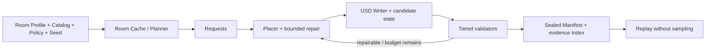

# Common Core V1.0 架構與資料契約草案

日期：2026-11-11。狀態：APPROVED_D01_2026-11-14。
規範依據：[Functional Spec](Common_Core_V1_Functional_Spec.md)；執行單元與測試見 [Roadmap](Common_Core_V1_Development_Roadmap.md)。D-01 已核准依本契約實作；介面與路徑是正式施工依據，完成狀態以單一 Active Plan 與驗收證據為準。

## 1. 檔案範圍與責任

```text
C:/hotel_room/
  _common_core_planning/                 # 本次文件與唯一 active plan
  common_core/                          # 整體方向確認後才建立
    AGENTS.md                           # 僅管此程式範圍及其新 run 行為
    run_core.py                         # 明確 code root 的薄入口，不依賴 caller CWD
    common_core/
      contracts.py                      # JSON 載入、型別／交叉欄位驗證、版本
      identity.py                       # hashes、stable IDs、RNG seed derivation
      room.py                           # profile → support/obstacle cache
      adapters.py                       # mesh/primitive；必要的房型邊界
      planner.py                        # Scenario × Level × Seed → requests
      placer.py                         # 幾何取樣、有界修正、attempt 結果
      geometry.py                       # 既有數學 helper 的最小萃取
      writer.py                         # source overlay + state authoring
      manifest.py                       # 權威 state、evidence refs、seal/read
      replay.py                         # 不採樣 restore；重用 writer
      validation.py                     # static/integrity/replay 與 scope
      native_validation.py              # native support query／有限 PhysX worker
      render.py                         # 原生截圖與相機 receipt
      cli.py                            # CLI 路由與 exit，不含 scenario 業務邏輯
      progress.py                       # 單元進度 receipt／摘要（M6）
      legacy.py                         # Hotel v2/必要 YAZHI importer；不跑舊 main
    config/
      rooms/hotel705.json
      rooms/yazhi.json
      catalog.json
      policy.json
      deployment.example.json           # 本機 source/SDK mount；不列入語意 fingerprint
      batch_v1.json                     # 36 個明確 case keys
    schemas/                            # JSON 契約文件；無新第三方 runtime 依賴
    tests/                              # stdlib unittest＋小型 synthetic USD fixtures
    docs/                               # 使用、限制、來源、交付重現說明
  _common_core_runs/                     # unique run / checks / spikes / deliveries
  YAZHI-TWIN/                           # 唯讀依賴
  _hotel705_reference/                   # 唯讀依賴
  _hotel705_pilot/                       # 唯讀依賴，舊 active pointers 亦不改
  _yazhi_randomizer_staging/             # 唯讀依賴，不改 Toolkit
```

以上是職責地圖，不是要求逐一建立大 package；小 helper 可以同檔，拆分須服務具體工作。程式來源採 Toolkit 交付殼與 Hotel 支撐方法，避免複製整條研究 import chain。重用 helper 時記原路徑／SHA／原函式及改動理由；禁止 import-time 執行歷史 build、sample、render 或 write。

## 2. 資料流與介面



| 介面 | 輸入 → 輸出 | 不變條件 |
|---|---|---|
| `load_inputs(config_path: Path, room_id: str) -> Inputs` | deployment/profile/catalog/policy → 已驗證契約 | path resolution 僅在邊界發生；無來源寫入 |
| `prepare_room(profile: RoomProfile, bindings: Bindings) -> RoomCache` | source USD → support/obstacle/initial state | cache key 包含 profile、source closure、extractor hashes |
| `plan_requests(inputs: Inputs, seed: int, scenario: str, level: str) -> Plan` | 純資料 → requests、targets | 不讀 USD、不寫檔、不 import Isaac |
| `place_requests(plan: Plan, room: RoomCache, catalog: Catalog, budget: Budget) -> PlacementResult` | requests → placements／failure records | 無 writer／native physics；所有分支有界 |
| `write_scene(output: Path, inputs: Inputs, placements: PlacementResult) -> SceneIdentity` | 來源＋effective poses → overlay | 不採樣；只寫新輸出；白名單 override |
| `validate_static(scene: Path, state: CandidateState, room: RoomCache) -> Assessment` | composed USD → readback／geometry | validator 不修改 scene |
| `validate_native(case: NativeCase) -> Assessment` | exact scene/state/targets → rays 或 dynamics | session-only 凍結／proxy opinions，不保存回來源 |
| `seal_manifest(state: CandidateState, evidence: list[EvidenceRef], output: Path) -> Manifest` | state＋已存在證據 → immutable manifest | explicit schema、evidence hashes；無 circular hash |
| `replay_manifest(manifest: Manifest, output: Path, bindings: Bindings) -> SceneIdentity` | saved effective state → 新 overlay | 禁止呼叫 planner/placer/RNG |
| `repair(plan: Plan, result: PlacementResult, assessment: Assessment, budget: Budget) -> RepairDecision` | 結構化失敗 → 新 attempt 或 terminal failure | policy 外姿態／source override 禁止 |

這些型別在 `contracts.py` 實作為小型 dataclass／已驗證 JSON；不引入 framework。跨文件同名即同一資料型別。新契約以明確 raise 處理錯誤；既有依賴仍含 assert 時入口拒絕 optimized Python，不能靜默略過。

## 3. RoomProfile 1.0

| 欄位 | 必要內容／規則 |
|---|---|
| `schema_version`, `profile_id`, `profile_version` | 明確版本；未知 major 拒絕 |
| `source` | logical mount、相對 USD path、root prim、root SHA、dependency closure ref/hash；不是直接嵌絕對機器路徑 |
| `coordinates` | native meters_per_unit/up_axis、轉 common meter/Z-up 矩陣；兩房先維持原值，未支援轉換時明確拒絕 |
| `supports[]` | stable support_id、source prim/collider path、kind（mesh_top/primitive_top/floor_region）、local frame、allowed region、edge margin、用途 tags |
| `forbidden_regions[]` | profile-local polygon/box、用途／高度範圍與 provenance；不宣稱導航認證 |
| `source_objects[]` | object_id、prim、FIXED/MOVABLE/ARTICULATED、允許操作、catalog link；原生 relocate 必須白名單 |
| `override_allowlist[]` | 精確 prim 與可改屬性；預設只允許選定原生物件的 transform/body state；新增 prim 放共用 namespace |
| `test_freeze` | native test 可凍結 body／joint 的條件；不是永久 USD 修改 |
| `cameras[]` | profile-local eye/target 或 source camera、用途、固定設定；僅供驗證／展示 |
| `provenance` | 標註者／mesh-derived／estimated，不將尺寸提升為人工 confirmed |

RoomCache 包含 source/profile/extractor identity、三角面／primitive footprint、obstacles、movable native 初始 world matrices／state 與 source prim mapping。Mesh top 方法沿用 Hotel；Cube/Cylinder top 以 analytic primitive／正確 world transform 產生支撐表示。傾斜／shear／不支援幾何回 UNKNOWN。每房只檢查所需 supports，不全面掃描研究歷史。

支撐驗證需要 footprint 面積／區域的保守包含，不只中心射線或四角。凹面／有洞面無法證明時拒絕該放置或限制為已證明的凸區；M0/WU-02 fixture 檢查此界線。Obstacle 的 triangle AABB 是保守近似，不能稱 triangle-triangle collision。

## 4. Asset Catalog 1.0

每個 entry 統一描述 external reference 與 native prim。必要欄位：`asset_id/version/category/origin/source_locator/dependency_hashes/root_prim/dimensions/provenance/license_scope/states[]`。

每 state：`state_id/version/usd_locator_or_native_prim/sha256/units/up_axis/pivot/alignment/visual_bounds/footprint/support_envelope/allowed_pose_tags/acceptance_refs/physics_proxy`。Mug 翻轉、Tea PCA 的已知固定對齊記在 state／adapter，不以資產名稱在核心特判。Native entry 以 source closure＋prim geometry signature 識別，不能要求不存在的獨立 USD SHA。

`physics_proxy`：`kind=box|cylinder|convex|compound|none`、`shape_paths`、geometry hash、relative transforms、mass/inertia/material refs（必要時 friction/restitution）、value provenance、`capability=STATIC_ONLY|DYNAMIC_CANDIDATE`。已知來源材質可引用，但不可把缺值當已校正值。`none` 不計動態 FAIL，也不計 PASS。M5 只對實際支援的代理路徑作動態宣稱；不要求一次把所有類型實作完。

Catalog 與 qualification 分離：`qualification_refs[]` 指向精確 case reports，沒有 `asset_globally_physics_pass=true`。S0 每 state 獨立身分、支撐與碰撞範圍；新形態不繼承舊 state 資格。

## 5. Scenario/Level Policy 1.0 與 RNG

Scenario 區：roles、eligible categories／states、ownership/action semantics、required/optional quotas、allowed support tags。Level 區：count ranges、coverage target/tolerance、support spread／state proportions、allowed poses、hard/soft flags、budgets。Room 可宣告容量／不可用類別，不可覆寫 Seed 語意。Policy 記 SYNTHETIC_RESEARCH_ASSUMPTIONS，不當酒店 SOP。

Planner 產生 `request_id/role/asset_id/state_id/origin/semantic_state/allowed_support_ids/allowed_pose_tags/required/priority`，並存 requested count/coverage/distribution。依固定 priority、stable ID 排序，不依當前檔案或 dict 偶然次序。

RNG v1：以 UTF-8 canonical JSON `["cc-rng-v1", seed, namespace, stable_id, attempt_ordinal]` 計 SHA256，digest 前 16 bytes 當無號整數初始化局部 `random.Random`。namespace 區分 count、asset、state、placement、repair；Scenario 可以列入 namespace。count quantile 不含 Level，映射到該 Level 非重疊區間。Placement RNG 不含 run timestamp、output path 或 Python hash。固定 Python／sampler 版本屬重現條件；不承諾跨 Python 版本同序列。

有限幾何預算初值：每 request 最多 3 個 allowed supports、每 support 800 samples（合計最多 2400）；修正 pass 最多 1 次，使用獨立 repair stream；總幾何 samples 每 request 最多 4800。Policy 可更嚴但不可無界。Physical 初試＋最多 1 retry；retry 新 attempt，並重做受影響 Static/Support/Visual/Replay。禁止物理結果偷偷改回原 pose。

## 6. Manifest 3.0：唯一權威 state

版本命名區分：RoomProfile/Catalog/Policy = 1.0；新輸出 Manifest = 3.0；產品 Common Core = 1.0。舊 Hotel schema 2 與 Toolkit wrapper 不是新 schema 的同義詞。

| 欄位 | 意義 |
|---|---|
| `schema_version`, `generator_version`, `run_id`, `attempt_id`, `parent_attempt_id` | 新格式與 lineage；舊 run 只由 importer 讀取 |
| `inputs` | code content inventory/hash、room/profile/catalog/policy/source closure refs/hashes、seed/scenario/level |
| `environment` | 完整 Isaac build、Python/USD、OS、GPU/driver、physics/render settings；無 secrets／全環境變數 dump |
| `requests`, `targets`, `achieved` | 實際 planner requests、數量／coverage／state 目標與達成值、所有 omitted／failed request |
| `objects[]` | instance_id、request_id、asset/state identity、source_object_id/native_prim mapping、before/after/effective state |
| `objects[].before` | native：exists=true＋來源 world matrix／相關 visibility/body/semantic state；added：exists=false，無虛構原 pose |
| `objects[].after` | 生成器擬定的 world matrix、state、support、semantics、body mode |
| `objects[].effective` | 該 attempt 實際 scene 的權威狀態；若採納 settled pose，必須新 attempt、更新 scene 並重新驗證 |
| `scene` | logical locator、USD SHA、composed state digest、dependency inventory；source hierarchy 保留 |
| `evidence_refs[]` | kind、URI、SHA、execution/outcome/scope、target_state_digest、producer identity；只引用已存在證據 |
| `failure_refs`, `attempt_lineage` | 小型摘要／parent IDs；詳細 sample／trajectory／debug 放附檔 |
| `limits` | 未驗證項、proxy／support 限制、授權範圍、human acceptance 狀態 |

權威規則：`effective` 是該 attempt scene 狀態唯一來源；`before/after` 僅描述歷史與提案。不能同時將 legacy `soft` 與 `refined_bedding` 當最終真相。新檔採相同 common world convention（meters/Z-up、Gf row-vector 4×4，平移在第 4 row）；importer 顯式轉換，寫入時用 parent inverse，不假設 root transform 是 identity。

狀態 canonical digest 排除 timestamp、絕對 mount、evidence、run/attempt ID；包括 requests、source/asset identities、effective poses／semantics。Validator 以 digest 綁定 candidate；seal 後 Manifest 再包含 evidence 檔案 hash，避免「Manifest hash 包含結果、結果又包含 Manifest hash」的循環。

Generate 封存最初 Static/Replay/Integrity evidence refs。後續 validate/render 對已 sealed manifest 寫**新 assessment bundle**（含 manifest SHA、state digest、實際證據 SHA）；不回改 manifest。`delivery_index.json` 只彙整每個 case 的 authoritative manifest URI/hash 與最新選用 assessment refs，**不存另一份 effective state**。因此狀態權威仍唯一；後續證據能追加而不破壞舊 hash。

## 7. Run 與 Evidence 結構

```text
_common_core_runs/<run_id>/
  request.json                         # immutable 輸入及 budgets
  attempts/a000/
    scene.usda
    manifest.json                      # sealed，寫入一次
    validation/{static,replay,integrity}.json
    sampling.jsonl                     # bounded rejects，必要時聚合計數＋代表樣本
    failure.json                       # 若失敗，含 phase/reason/request/budget
  attempts/a001/                       # repair child，保留 a000
  assessments/<assessment_id>/
    index.json                         # manifest SHA/state digest/evidence hashes
    support.json / visual.json / physics.json
    renders/ / native/                 # 真圖／原始 trajectory／contact／exit/log
  run_index.json                       # atomic view，指向選用 attempt，不藏失敗
```

Unsealed candidate／STARTING／crashed run 不得偽裝成 complete。final manifests／receipts／assessment immutable；只有 active view/index 可 atomic replace，必須可從 receipts 恢復。重啟後先 inspect：已有 native dispatch claim 時不自動重送；native 結果缺失標 incomplete，另建 attempt 才可再跑。結果先寫新檔後 publish index；不中途刪除失敗。

## 8. 路徑、相容與 CLI

Deployment bindings 將 `room_hotel`、`room_yazhi`、`asset_pool`、`isaac_root` 映射到本機位置，URI 依明確 mount＋relative path 解析，不依 caller CWD。輸入相對路徑以其所在 config 檔案為 anchor，CLI output 以 caller CWD 為 anchor且顯示 resolved path。USD authored arcs 一律相對；logical identity 不含機器路徑。

Runtime 執行器必須確認所用 Python／USD 來自設定 SDK。歷史版本基線為 Isaac `6.0.0-rc.59`；M0 再讀本機 VERSION，不透過升級解決相容。未知版本先明確標未支援，依短 smoke spike 擴支援，不默認 certified。

所有 output 必須是新目錄，拒絕 source roots、source 子目錄、既有 run、路徑逃逸與 reparse redirect；不能繼承 Toolkit 的「只可寫舊 deployment 目錄」限制。preflight 不建 scene／run；validate、replay 寫新 assessment/output。Import legacy 僅允許 explicit read，不執行歷史 verify（它會覆寫證據）。

未來命令契約（本次未實作）：

```powershell
$core = 'C:\hotel_room\common_core'
$py = 'C:\isaac_sim\kit\python\python.exe'
$cfg = "$core\config\deployment.local.json"
& $py -B "$core\run_core.py" preflight --config $cfg --room hotel705
& $py -B "$core\run_core.py" generate --config $cfg --room hotel705 --scenario STAYOVER --level low --seed 706 --output 'C:\hotel_room\_common_core_runs\example new run'
& $py -B "$core\run_core.py" replay --config $cfg --manifest '<manifest.json>' --output '<new-output>'
& $py -B "$core\run_core.py" validate --config $cfg --manifest '<manifest.json>' --tiers static,support,replay --output '<new-assessment>'
& $py -B "$core\run_core.py" batch --config $cfg --spec "$core\config\batch_v1.json" --output '<new-batch>'
```

Exit：0=所請求層通過（不代表未請求層），2=參數/schema，3=identity/依賴，4=取樣無解，5=驗證不過，6=native incomplete/timeout，7=output/權限。batch 保存逐案狀態；任一必達 case 失敗則 batch 非 0。`--tiers all` 展開需明確，不能自動把未 qualified 物件全改 dynamic。

> D-01 approved 2026-11-14: [binding execution supplement](D-01_Approval_2026-11-14.md) supersedes historical planning-only, no-local-commit and per-scene S0 wording. Execution state is maintained in the single Active Plan.
