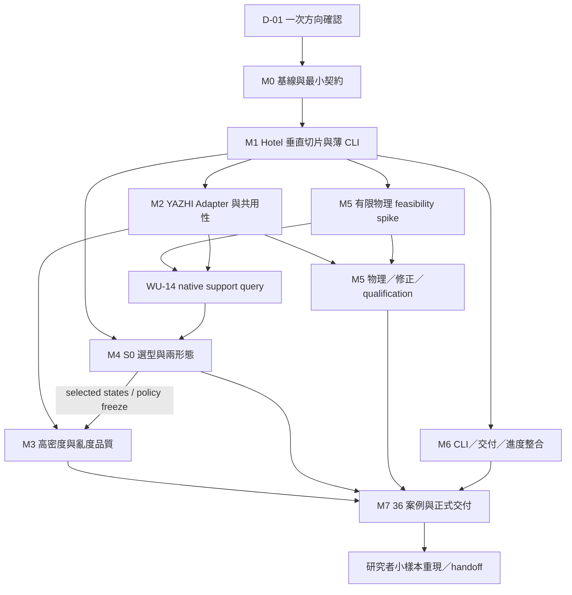

# Common Core V1.0 Development Implementation Plan

> For agentic workers: 採 Codex 原生連續執行；本計畫不要求逐單元子 Agent 或第三輪全面審查。D-01 已核准，依前置依賴選取 READY 單元。每單元驗收後保存實測證據並允許在新 common_core Repository 本地 commit；不得 push 或發布。

**Goal:** 以 Hotel 705 垂直切片建立資料優先的薄核心，以 YAZHI 驗證共用性，交付可重現的 36 案例、S0 與精確範圍的有限物理驗證。
**Architecture:** RoomProfile/Catalog/ScenarioLevelPolicy → Planner → Placer/有界修正 → USD Writer/Manifest/Replay → 分層 Validators。Room Adapter 吸收 prim、支撐及座標差異；既有成果是唯讀依賴。
**Tech Stack:** Python、OpenUSD、既有 Isaac Sim Windows bundled Python／CPU PhysX；新純資料測試用 stdlib unittest；不預設 pip 安裝、新框架或額外 API。
**Spec:** [最終功能規格](Common_Core_V1_Functional_Spec.md)；[架構／契約](Common_Core_V1_Architecture_Contracts.md)。
**Status:** APPROVED_D01_2026-11-14；實作已啟動，M0–M7／WU 的實際狀態以單一 Active Plan 為準。原規劃日期：2026-11-11。

## Global Constraints

- Seed、Scenario、Clutter Level 必須分離。
- 採用小型 Room Profile、Asset Catalog、Scenario/Level Policy。
- Manifest 必須有權威的狀態定義與 Evidence References，不要求將所有大型日誌放入單一檔案。
- 動態 PhysX 資格必須綁定精確測試範圍。
- S0 至少一類兩種形態；S1/S2 不阻塞 V1.0。
- 不導入不必要的通用 Solver、Predicate DSL 或 LLM Agent。
- 不因架構整理而破壞現有 YAZHI、Hotel 705 與 Toolkit 成果。
- D-01 允許在 common_core 開發、_common_core_runs 保存新證據、_common_core_planning 管理計畫；既有房型、Toolkit、原始 USD、資產與歷史證據保持唯讀。僅新 common_core 可建立本地 Git 與驗收後 commit；不得 push、發布或使用額外付費 API。
- D-01 整體方向確認已完成；依驗收與依賴連續自主實作，不逐單元重新設 Human gate。

前兩條文件的數字門檻是**待整體確認的工程提案**，不是歷史實測結果；後續 calibration/spike 的產物須保存設定、結果與版本，不能將 proposed 標成 executed。

## Review Focus

| 易漏風險 | 指定測試／責任 |
|---|---|
| Seed705/709 超出舊 recipe 索引；同 Seed 不同 Level | WU-01/04：signed32 邊界、705/709、三 Level 單調數量與 stream 隔離 |
| YAZHI primitive、父 transform、凹支撐／孔洞 | WU-02/07：Cube/Cylinder/Mesh/nonidentity-parent、孔洞 fixture，UNKNOWN 不當 PASS |
| 原生 amenity／S0 state 的身分與 collision 不一致 | WU-03/12/13：native before/after、state SHA、unsupported proxy、source whitelist negatives |
| 相對 USD arc、不同 CWD 與路徑含空白 | WU-06/18：relocation composition、不可覆寫／逃逸負向測試 |
| Native 中斷、舊 PASS 或 stale image 沿用 | WU-15/16/20：dispatch claim、new attempt、state/evidence hash mismatch 拒絕 |

## 1. 決策、狀態與來源

一次方向確認 D-01（DECISION_REQUIRED）涵蓋：`common_core/` 程式範圍、`_common_core_runs/` 新輸出、兩房固定家具、資料契約／Manifest 3.0、Scenario/Level/Seed 分離、S0 候選選型權限、有限動態及 36 案例、Codex 在此範圍內自主修復。未收到明確確認前，不執行 WU-00。

`READY` 是方法與需求足以施工，並不代表前置單元已完成。`SPIKE_REQUIRED` 是限定輸入、次數、產物的技術查證。`RESEARCH_REQUIRED` 是可延後學術問題。`DECISION_REQUIRED` 僅用於方向／權限／交付接受，不用於普通 bug。執行狀態另用 NOT_STARTED/IN_PROGRESS/COMPLETE/FAILED/WAITING_DEPENDENCY，由單一 active plan 記錄。

基線沿用三份輸入的來源圖，M0 只 pin 會用的 dependency closure 與關鍵 helper，不重新盤點整個 workspace。歷史 Hotel Room-scale 六場景／95 rays／四 finite cases 是 RECORDED_PASS；YAZHI 多份研究候選依 adopted 記錄選取。Toolkit shell 來源 commit 為 `92d171937b517cd3a32b2a5ecfd48a83a4dec2ff`，實際讀到的 helper bytes 仍需 pin。整合摘要對 Claude 的修正優先：不要求全 clutter dynamic、不把 rejection sampler 稱 PhyScensis 同演算法、不以 S1 或毛巾 bake 作必要依賴。

## 2. Milestone Dependency Map



M4 選型可在 WU-01 後先做資料比較，實際跨房驗收等 M2。M5 spike 在 M1 後可先用 Hotel 小案例；正式資格驗收需 M2/M3 穩定的目標配置。M6 的交付設計可提早，最終 package 要含 M3/M4/M5 穩定設定。這是工作流可重疊，不代表本次啟動平行 Agent。

正常推進順序：WU-00 → 01 → 03–06 → 02/07–08 → 09–10；其間插入 11、13、17/19 可獨立工作，最後完成 12、14–16、18，再到 20–22。WU-02 也可提早，但不得為等它延後 Hotel 切片。

## 3. 正式 M0–M7

### M0 — 基線與最小契約

1. **Goal:** 將方向轉成可執行的資料邊界，保護來源並消除 Seed 語意與 YAZHI support 的關鍵不確定。
2. **Current Reuse:** Toolkit `runtime_support` 的 identity/closure/output guard 思路；Hotel `prepare.top_triangles`、`pilot.signature/rel`；YAZHI `geometry_check.extract_primitive`。不執行任何舊 main。
3. **Required Changes:** 只在新 `common_core/` 建立最小 loader、identity、契約／測試與 readonly source lock；既有檔案不修改。Schema 為可演化 draft，不先假設兩 adapter 已完整。
4. **Dependencies:** D-01。WU-02 只需 WU-00 的 locator，不是 M1 阻塞。
5. **Work Units:** WU-00 READY；WU-01 READY；WU-02 SPIKE_REQUIRED。
6. **Deliverables:** source/helper inventory（logical locator＋SHA）、RoomProfile/Catalog/Policy/Manifest draft、RNG tests、YAZHI support probe receipt、實作範圍 AGENTS。
7. **Acceptance Tests:** 正反例契約測試、Seed705/709/邊界、unknown schema、錯 SHA；兩房 source root/所需 closure 身分可追溯；probe 至少一 Mesh/Cube/Cylinder synthetic fixture 加實際選定 YAZHI supports。若某形狀不支援，有小 adapter 路線，不宣稱通用成功。
8. **Failure / Rollback:** 將失敗寫新 check receipt；source 缺失只阻擋該房／asset，先做 synthetic 契約／Hotel 可用路徑；不下載、不重建、不修 source。保留 scaffold，停用有問題的新 profile version。
9. **Completion Definition:** WU-00/01 完成；WU-02 產生明確 adapter 決策與 fixture（未知結果不強稱 PASS）。YAZHI adapter 的真正實作於 M2；M0 不能因只寫規劃文件而標完成。

### M1 — Hotel 705 資料驅動垂直切片

1. **Goal:** 第一個從 Profile/Catalog/Policy 到新 USD/Manifest/Replay 的真實共用核心，1 房 × 2 Scenario × 3 Levels。
2. **Current Reuse:** Hotel `prepare.py` 支撐／障礙提取、`generate.height/support_ok/set_world/author` 方法；Toolkit CLI/closure/asset validation；舊 recipe 只作 legacy fixture。
3. **Required Changes:** 新 Hotel Profile、原生/外部 Catalog、Planner、Placer、Writer、Manifest、Static/Replay；薄 generate/preflight CLI 從此可用。移出 mug flip／tea 對齊特例。
4. **Dependencies:** WU-00/01；不等待 M4/M5。
5. **Work Units:** WU-03/04/05/06，均 READY。
6. **Deliverables:** `config/rooms/hotel705.json`、catalog/policy、最小 `run_core.py`、六個 unique runs、Static/Replay/Integrity、一次配對 Visual smoke、legacy import regression。
7. **Acceptance Tests:** Seed706 同情境三 count 目標嚴格遞增；STAYOVER/CHECKOUT 資格與 state 差異可解釋；Seed705/709 不觸發 recipe indexing；同設定重產與無 RNG Replay；白名單外 source override／越界／錯 asset SHA 被拒絕。六個切片案例 Static/Replay/Integrity EXECUTED_PASS；至少一組匹配實圖審查，其餘 Visual 可明列 NOT_RUN，最終 M7 補齊。
8. **Failure / Rollback:** 每次 candidate 新 run，不覆蓋 Hotel 歷史 active batch；無解保存 requests/targets/budget/reason。恢復到前一通過的 Common Core code/profile snapshot，不改舊房間。舊 fixture 與新生成的結果不可混算。
9. **Completion Definition:** 薄 CLI 完成六個新場景及指定 smoke；核心無 `seed-706`／Seed recipe table；完整 before/after/native mapping；舊六場景 legacy replay 的 composed state 保持。

### M2 — YAZHI 第二房型 Adapter

1. **Goal:** 以第二房型實測抽象，保持相同 Planner、Placer、Writer、Manifest、CLI。
2. **Current Reuse:** YAZHI primitive extraction、Circle/OBB/SAT；既有家具／collider ownership 記錄；Toolkit asset lock。Canonical build 不執行。
3. **Required Changes:** `adapters.py/room.py` 支援 primitive top、profile transforms；新 YAZHI Profile，家具固定；核心如需修正只接受無房型專名的一般欄位。
4. **Dependencies:** M1 核心；WU-02 probe 結果。
5. **Work Units:** WU-07/08 READY。
6. **Deliverables:** 第二 profile、analytic top fixtures、兩房 paired CLI smoke、genericity regression。
7. **Acceptance Tests:** YAZHI 2 Scenario × 3 Level 同 Seed 六案 Static/Replay/Integrity；Mesh/Cube/Cylinder 支撐與 nonidentity parent transform；原始 prim/joint 集合及未授權 transforms 不變；測試把 profile 改 root/位置後仍能工作；native query 待 M5。
8. **Failure / Rollback:** 若 primitive 不可處理，先限制 profile 到已證明的 support 或建立 analytic adapter；不得重建／flatten source 掩蓋問題。新 schema 變更時兩房 fixtures 一起跑，舊產物不改。
9. **Completion Definition:** 兩房同入口／同核心；`planner/placer/writer` 不含 `/root/_7052_*`、`/YAZHI_TWIN` 或世界位置常數；必要特例在 profile／adapter 可解釋。

### M3 — 亂度品質與高密度可行率

1. **Goal:** 讓 Level 真正控制 requested/achieved count、coverage、分散／形態，測得可行範圍後凍結 release policy。
2. **Current Reuse:** bounded rejection、support fallback、Circle/OBB/SAT、既有 composition diversity 檢查；不先引入新 solver。
3. **Required Changes:** 版本化 metrics、capacity masks、可解釋 targets；只有高密度不足時改 conservative footprint 或加入已標註 floor region。
4. **Dependencies:** M2；M4 state 可先占預留 footprint，最終 policy freeze 要以選定 S0 重檢。
5. **Work Units:** WU-09 SPIKE_REQUIRED；WU-10 READY。
6. **Deliverables:** calibration seeds 7001–7003、固定候選 budgets、成功率/原因/耗時、target/actual 表、凍結 policy/metrics version。
7. **Acceptance Tests:** calibration 36 組（可先只跑幾何，不渲染／native）全部硬約束達標；每 room/scenario count 嚴格分級、mean coverage 遞增、至少一分散／形態目標隨 Level 改變；同 Seed 重現。只有 hard thresholds 皆過才可 freeze；軟指標清楚標 deviation。
8. **Failure / Rollback:** Spike 限一個 baseline＋最多兩種局部改良（OBB/保守凸區、floor mask 等），最多 3×36 次幾何-only case，不無限調參。仍不足則先保留可行設定，記錄無解；若 proposed high count 必須改變，於 calibration 版修訂並記原因、保留嚴格三段範圍；不得在正式 M7 偷改。需要超出 V1 支撐／資產範圍才找 Human。
9. **Completion Definition:** 有凍結政策、可重現 calibration 結果與未解限制；沒有以少放物件或換 Seed 冒充達標。高密度新演算法研究可另列，不阻塞其他 READY 單元。

### M4 — S0 一類兩形態

1. **Goal:** 交付兩種可辨 mesh state，能在兩房使用，S1 不作前提。
2. **Current Reuse:** 已採用毛巾／Neat/Compressed Pillow library、state selector、support projection/geometry 方法與來源 SHA；DO_NOT_ADOPT 候選維持排除。
3. **Required Changes:** state catalog、pivot/support envelope、允許 pose；只新增獨立 overlay/reference，不停用未授權原生床品。
4. **Dependencies:** WU-01 契約；選型可提早；跨房驗收依 M2，加入 policy 最終依 WU-10。
5. **Work Units:** WU-11 READY（有條件 SPIKE_REQUIRED）；WU-12 READY。
6. **Deliverables:** 選型比較（毛巾先、枕頭備案）、兩 state 資產身分、8 個 support/pose 檢查、真實圖片與審查、replay。
7. **Acceptance Tests:** 2 rooms × 2 states × 2 平面支撐位置 = 8 案；Static/Support/Visual/Replay；state change 非單純轉向；36 案例依 Scenario/Level Policy 決定是否放置 S0，兩形態仍須於每房/Scenario 都出現。若為無 dynamic proxy，保留 STATIC_ONLY 合法 scope。
8. **Failure / Rollback:** 毛巾若需 duvet 貼合則不直接宣稱跨房有效，改測已有枕頭。只有兩者都不足才做一次最多兩個候選的靜態形態 spike；可考慮一次離線 bake，但需有資產/工具授權且不變成必須做 S1。失敗保留候選，不覆蓋 adopted library。
9. **Completion Definition:** 至少一類兩形態完整 evidence 與 policy 接入；需要視覺修正的 state 不標 accepted。離線研究未解不妨礙其他工程，但 S0 最小必達仍需完成。

### M5 — 代表性有限物理與有界修正

1. **Goal:** 在真正支援的 proxy 上驗證 source/support/pose 精確範圍，將可修復失敗接回新 attempt。
2. **Current Reuse:** Hotel contact/tensor trajectory/native exit、oriented collider corners；YAZHI qualification identity、dispatch guard/reset/replay；不複製舊 qualification 到新配置。
3. **Required Changes:** NativeCase 契約、proxy capability gate、support queries、有限 CPU PhysX、failure enum/repair、assessment refs；多 shape 非必須一次全支援，未支援 entry 明列 STATIC_ONLY。
4. **Dependencies:** WU-05 可以開始 Hotel spike；正式跨房依 M2。M5 以版本鎖定 fixture 完成 worker／修正能力；最終 release representative cases 在 M7/WU-21 依凍結 geometry/policy 重新比對或重測，不以等待 M3 阻擋 native query/S0。
5. **Work Units:** WU-13 SPIKE_REQUIRED；WU-14/15/16 READY。
6. **Deliverables:** proxy feasibility receipt、兩房 support queries、代表性 dynamic cases、修復與耗盡對照、exact-scope qualification records。
7. **Acceptance Tests:** 至少兩房、兩類 support geometry（圓形/矩形或 mesh/analytic；類別在 case 清單明列）、一例兩物件同時 dynamic；每 case 240 measured steps/120 Hz，初始化 callbacks 分列；expected source contact、無非預期接觸、footprint retained、最大下穿 ≤3 mm、位移 <3 cm、末 30 步速度 <0.01 m/s 且角速度 <0.1 rad/s、native exit 0。這些是沿既有限定案例的提案門檻，不代表自然物理真值。native initial pose 對 composed matrix 的位置與角度分別比較（≤3 mm／≤0.1°），不可只看 translation。
8. **Failure / Rollback:** feasibility 最多 4 次 native attempts（含失敗），先 Book/Tissue 可支持 proxy，無需全房 dynamics。每次 240 s watchdog、8 GiB child RSS 初始 cap；若資源不足保存 INCOMPLETE，由 Codex 依 preflight 記錄調整較小 case，不無界增加資源。實際 M5 case 最多初試＋一次修正；原 source session 不 save。runtime error 先修 worker，小 fixture 重驗，不擴大 qualification。
9. **Completion Definition:** 覆蓋所宣稱代表範圍；可修復與不可修復各一實測案例；budget 耗盡保存 FAIL，沒有 hidden redispatch；qualification 的 input/collider/state/runtime fingerprint tamper 能拒絕。不要求所有 native amenities/cans/paper/S0 dynamic。

### M6 — 交付工具化與進度整合

1. **Goal:** 將 M1 CLI 擴展為可移交工具，保留不同 CWD／新目錄能力及可恢復進度。
2. **Current Reuse:** Toolkit parser、version/closure、guard/failure JSON、重定位 QA、既有研究報告的 evidence link 格式。
3. **Required Changes:** 完整 CLI、batch、environment bindings、輸出封裝／checksum、README/例子、WU progress writer；不發布遠端、不自動邀請研究者。
4. **Dependencies:** M1 可先做外殼與文件；最終 package 依 M2–M5 正式版本。WU-19 只需 WU-01。
5. **Work Units:** WU-17/18/19 READY。
6. **Deliverables:** 五命令入口、batch spec、diagnostic exit codes、relocation receipts、code/asset lock、進度與週報 evidence 索引。
7. **Acceptance Tests:** 從 C:/Windows 等不同 CWD、全新含空白 deployment 路徑使用 absolute CLI/config；source/asset logical mounts 改位置後相同 state digest；現有 output/來源目錄/escape/reparse 拒絕；batch 失敗保留逐案紀錄；失敗／中斷 progress 不被標完成。
8. **Failure / Rollback:** 新交付目錄與 asset-copy allowlist；不能原地替換舊包。授權未足夠時交付 code-only＋dependency acquisition/bindings，受限資產不跟包；內部功能測試繼續。修 CLI 不改 sampler 或既有 Toolkit。
9. **Completion Definition:** 所有命令、文件、版本、failure diagnosis、relocation 與單元進度 receipt 一致；無隱性依賴原 staging Python 模組／原機寫死 path。

### M7 — 36 案例、回歸與最終交付

1. **Goal:** 以凍結輸入完成 36 個獨立 case，交付另一研究者可重現的 V1。
2. **Current Reuse:** 既有分層驗證、tamper negatives、圖片 hash-bound review、artifact index。歷史 PASS 僅回歸參照。
3. **Required Changes:** 只整合 acceptance batch、缺陷修復、release evidence index/summary；不為追求展示加入新研究算法。
4. **Dependencies:** M2/M3/M4/M5/M6；正式 Seed 固定 706/707/708，不是原 Hotel 三個 seed recipe。
5. **Work Units:** WU-20/21 READY；WU-22 技術準備 READY，研究者實際操作與 handoff 簽收 DECISION_REQUIRED。
6. **Deliverables:** 36×case outputs/assessments、有限動態 coverage matrix、integrity/protection、delivery index、Quick Start、known limits、研究者重生成 receipt。
7. **Acceptance Tests:** 下節 A01–A14；36 案全部適用硬層 PASS，Visual 審查者明列、每 case dynamic scope 明列。研究者以文件於新目錄完成兩房各一案（Hotel STAYOVER/low/706；YAZHI CHECKOUT/medium/707），再 replay/validate，保存環境與結果。不同實體機器若可得一併驗證；最低門檻仍是另一研究者獨立操作，不能用作者自測替代。
8. **Failure / Rollback:** 一案失敗→保留 batch／失敗 run，修 code/policy 時 bump identity，再重新產生受影響矩陣；公共 Planner/Placer/Writer 改變需重跑全部 36，單 profile 改變至少該房 18，僅報表改變不重跑 physics。不能補貼舊圖片或換掉失敗 Seed。舊 release candidate 不覆寫。
9. **Completion Definition:** LOCAL_RC_COMPLETE 需自動矩陣與代表性測試通過；V1_HANDOFF_ACCEPTED 另需研究者重現及 Human 接收明確 scope。若暫無研究者，保留交付未完成狀態，其他工程可完成，不杜撰 cross-machine PASS。

## 4. 可執行 Work Unit Backlog

以下檔案均在未來 `common_core/` 下；證據均在新 `_common_core_runs/`。所有單元初始 NOT_STARTED。每個單元實施共同循環：讀 prerequisites → 寫有意義的失敗/負向測試 → 最小實作 → 指定測試/實際 readback → 保存 evidence/失敗 → 更新 progress → 選下一個可啟動單元。無源碼變更的 spike 用測量/結論取代 TDD，不寫只照抄實作的測試。

| Unit / 性質 | 前置 | 檔案與 Inputs → Outputs | 指定測試／完成 evidence |
|---|---|---|---|
| WU-00 READY 基線及執行邊界 | D-01 | `AGENTS.md`, `contracts.py`, `identity.py`, `tests/test_contracts.py`, `config/source_lock.json`；三輸入及選定來源 → readonly locks／最小 load+validate | `test_contracts.py`：有效最小契約可讀、錯 source hash/major schema/白名單衝突拒絕；source before/after SHA 相同；完成 first-unit receipt |
| WU-01 READY 契約與 RNG | 00 | `schemas/*`, `contracts.py`, `identity.py`, `tests/test_identity.py`；draft → dataclasses、validation、RNG v1 | 705/709/signed32 邊界、超界拒絕、不同 CWD 同 fingerprint、追加 request 不改既有 RNG draws；catalog state/proxy/Manifest 正反例 |
| WU-02 SPIKE_REQUIRED YAZHI support | 00 | `adapters.py` probe、`tests/test_supports.py`；選定 prim types/transforms → analytic/mesh adapter 決策 | 最多 6 個實際 supports 只讀 inspect＋Mesh/Cube/Cylinder/孔洞/parent fixtures；明列適用/不適用，無 native sim |
| WU-03 READY Hotel Profile/Catalog | 01 | `room.py`, `adapters.py`, `config/rooms/hotel705.json`, `catalog.json`；來源＋locks → RoomCache/native initial state | 三已知 supports mesh height/obstacle fixture，原生 mapping/對齊/state identity，缺 collider/錯 SHA 拒絕；不寫舊 adapter.json |
| WU-04 READY 參數化 Planner | 01,03 | `planner.py`, `policy.json`, `tests/test_planner.py`；Scenario/Level/Seed → Plan | 新 Seed、同 Seed 六組、count 單調、required category/ownership、role IDs 穩定、沒有 seed recipe index |
| WU-05 READY Placer/Writer/薄 CLI | 04 | `placer.py`, `geometry.py`, `writer.py`, `manifest.py`, `cli.py`, `run_core.py`；Plan/RoomCache → 新 scene/manifest/static | `test_placement.py`、`test_writer.py`；1 房六案、collision/off-support/override negatives、parent inverse、gap/依賴；unique output |
| WU-06 READY Replay/legacy | 05 | `replay.py`, `legacy.py`, `validation.py`, `tests/test_replay.py`；新 manifest＋六舊 Hotel v2 → 新重建輸出 | 禁止 RNG sentinel；pose ≤1e-8 matrix element；geometry/semantics/原生 state 相同；relocated authored arcs 正規化後比對；tamper 拒絕 |
| WU-07 READY YAZHI adapter | 02,06 | `adapters.py`, `config/rooms/yazhi.json`, `tests/test_yazhi.py`；固定家具 profile → 第二房六案 | 同 CLI/核心、analytic supports、source/joints/非目標保持、兩情境三亂度 Static/Replay |
| WU-08 READY 兩房抽象回歸 | 07 | `tests/test_profiles.py`；兩房 profile＋synthetic translated room → 共用性 receipt | 核心 namespace/world constant scan、profile 移位／根名測試、unknown geometry 不當 PASS、無歷史 main import |
| WU-09 SPIKE_REQUIRED high feasibility | 08 | `geometry.py/placer.py`（只必要改動）、新 spike config/receipt；7001–7003 → 失敗原因/成功率/成本 | baseline＋最多兩種局部候選，最多108個幾何-only cases；有界終止；改善不得降低 safety/硬目標 |
| WU-10 READY metrics/policy freeze | 09,12 | `policy.json`, `validation.py`, `tests/test_levels.py`；count/coverage/spread/state 測量 → frozen targets | calibration36全硬目標、mean coverage 趨勢、分散或state差異、same-seed；記所有目標修訂；M7前凍結 |
| WU-11 READY S0 選型；不足轉 SPIKE_REQUIRED | 01 | catalog entries／新選型 receipt；已採用 towel/pillow → 一類兩state | 比較 provenance/pivot/footprint/permissions；既有 accepted state 優先；必要新形態最多兩候選，不要求 runtime cloth |
| WU-12 READY S0 integration | 07,11；最終Support驗收14 | `catalog.json`, `planner.py/placer.py` 通用 state 欄位、`tests/test_s0.py`；兩state → 兩房8案 | Static/Support/Visual/Replay、兩形態真正不同、無未授權 hide source bedding；為policy提供固定footprint |
| WU-13 SPIKE_REQUIRED proxy/native feasibility | 05,01 | `native_validation.py`, `tests/test_proxy.py`、新 case receipt；Catalog proxy → supported capability | Cube baseline、至少一可行非單Cube/compound候選的能力測試（不強制全通過）；無代理/錯shape gate；最多4次native啟動，明列scope |
| WU-14 READY Native Support/PhysX | 07,13 | `native_validation.py`, `render.py`, `tests/test_native_cases.py`；scene+NativeCase → 新 assessments | 原生support正/負fixture；兩房/兩support類型/兩body；240steps120Hz、contact/velocity/pose/exit；不保存session |
| WU-15 READY bounded repair/failure | 14 | `placer.py`, `manifest.py`, `tests/test_repair.py`；Assessment → RepairDecision/new attempt | 一個可修復初始不穩/碰撞fixture＋一個無解fixture；最多1 native retry；錯runtime/identity不重抽；耗盡FAIL可追溯 |
| WU-16 READY exact qualification | 15 | `validation.py`, `manifest.py`, `tests/test_qualification.py`；native evidence → scope record | 改source/asset state/collider/support transform/pose/runtime/physical settings 各拒絕舊資格；old PASS 無法覆蓋新配置 |
| WU-17 READY CLI/batch | 06,08 | `cli.py`, `config/batch_v1.json`, `tests/test_cli.py`；config＋case keys → 逐案runs/index | 五命令、nonzero exit、一案失敗不取消其他待執行案、不換seed、preflight零輸出、output guard |
| WU-18 READY package/repro | 10,12,16,17 | `docs/*`, `deployment.example.json`、新delivery index/checksums；完整依賴 → 可移交包/綁定說明 | 不同CWD、新含空格位置、logical remount、same state digest、missing asset/version/read-only source negatives；授權逐檔範圍 |
| WU-19 READY progress/weekly source | 01 | `progress.py`, `tests/test_progress.py`；單元receipt → ledger/progress/週報摘要 | 完成須有實測receipt；重啟不重複完成事件；失敗／中斷留存；摘要每項可點回evidence；不啟用hooks |
| WU-20 READY final36 | 10,12,16,17,18 | frozen batch＋render/validator → 36 run bundles/assessments | A01–A10，36個唯一case keys，7層結果分開；state/image identity驗證；缺案／FAIL阻擋整組接受 |
| WU-21 READY dynamics/regression | 20 | 選定 final cases＋必要舊fixture → 代表性native與回歸總表 | A11–A13；M5 qualification若與final exact identity不同就重測所選子集；不自動繼承 |
| WU-22 READY 準備；DECISION_REQUIRED 獨立操作/接收 | 19,20,21 | Quick Start＋新deployment → 另一研究者2案及replay receipt | A14；研究者環境與錯誤可追溯；作者不能代簽；不足時標LOCAL_RC_COMPLETE，待實際handoff |

WU-12 的 Support 測試依 WU-14 實際 native query 完成；在此前可先完成靜態／視覺準備，但不能將該層標 PASS。WU-10 的資料校準可提早做，最終 freeze 等 WU-12 selected states；這不構成與 M5 的循環依賴，WU-14 不依 WU-10。

## 5. Acceptance & Regression Strategy

本節只定未來測試，**本次一項場景測試都未執行**。

| ID | 測試與硬門檻 | 執行時機／證據 |
|---|---|---|
| A01 Integrity | code/profile/catalog/policy/source closure identity；來源檔案 SHA 與非白名單 state不變 | 每新case pre/post；錯hash/missingdependency負向 |
| A02 Seed/Level | 同版本相同inputs → plan/state digest一致（忽略run/time/path）；低中高count嚴格遞增；705/709合法 | 單元＋M1/M3/M7；不同Python/SDK不假定相同 |
| A03 Planner semantics | 兩Scenario eligibility/state差異；guest/unknown/left-behind不自動垃圾；必需類別存在 | 每case；metadata tamper fixture |
| A04 Geometry | profile region、連續footprint包含/保守證明、object-obstacle/object-object分離；初始gap目標1mm、允差0.1mm；S0最低可見支撐clearance0.5mm | Static actual composed readback；無支援形狀UNKNOWN而非PASS；容差版本化 |
| A05 Source hierarchy | 相對overlay、native initial→final mapping；固定家具/非目標prim/joint意見不變 | 每case；未授權root override負向 |
| A06 Native Support Query | 36案每物件至少中心及適用footprint採樣點的source collider hit，source height誤差≤2mm；保留所有hits/排除規則 | native kinematic query，可同process順序開scene；不是動態證據 |
| A07 Visual | 每case至少2個可辨的真實fixed-camera views，合計至少72圖；遮擋時增加detail；逐圖review scale/float/interpenetration/naturalness，hash-bound reviewer結論 | M7，agent review標明agent，Human pending不偽造；黑圖/未編碼圖FAIL |
| A08 Manifest Replay | 36案逐一不採樣重建；matrix最大元素誤差≤1e-8；geometry/state/semantics/material bindings/dependencies相同 | 新output；不能僅複製原scene；不要求bytewiseUSD/不同path相同text |
| A09 Level achieved | 每case count/required category/凍結coverage硬區間通過；每房Scenario的三Seed mean coverage遞增；分散或形態指標達所設Level差異 | 凍結M3policy；requested與achieved逐欄列；不silentdegrade |
| A10 S0 | 36案依Scenario/Level Policy決定是否放置；一類兩state在每房每Scenario均出現；8個專門state/support cases過Static/Support/Visual/Replay | state SHA及asset source明確；STATIC_ONLY合法 |
| A11 Limited Dynamics | 兩房、至少兩support幾何類型、一個兩body；套用M5步數/速度/penetration/pose/exit條件 | final scene exact scopes；未選物件NOT_RUN/STATIC_ONLY；不是36整房simulation |
| A12 Repair | 可修復與不可修復各一；最多一次physicalretry、明確budget/lineage與terminalreason | 初試失敗與修正後結果皆保留；mock只能驗controller，至少一組真native回饋 |
| A13 Regression/Tamper | 舊Hotel6案import replay、source/pose/state/collider/runtime/evidence/image篡改、output逃逸、native中斷不重dispatch | 不重跑全部歷史render/physics；legacy定位正規化後composed comparison |
| A14 Delivery Reproducibility | 新路徑含空格＋不同CWD；另一研究者按文件完成指定兩房案例/replay/validate | 環境、操作者、commands/exit、state比較；跨機physics非bitwise承諾 |

### 回歸分級與執行成本

- 純資料／RNG／schema 改動：對應 unittest＋Planner fixtures；進入 sampler/writer語意時才重跑新場景回歸。
- Geometry/Writer/Manifest 改動：兩房小切片＋負向測試；到 release identity 改變時依 M7 failure規則重建矩陣。
- Native worker/proxy改動：synthetic小案例、所改shape及代表性多body；不觸發歷史全房重驗。
- 文件／報表修正：links/schema/receipt readback；不為「fresh verification」無故啟動Isaac。
- GPU native工作順序執行，不併發啟動多個Isaac。render與rays可各自一個process循序開多scene；dynamic按case隔離，避免共享session污染。若合併query與physics，兩層仍各自保存設定和結果。
- 每個negative fixture明確預期reason/exit，不以「拋任何exception」當測試通過；單元完成需有新命令/exit/結果，不以test檔名或README當PASS。

## 6. Risk / Research Issues

### 工程風險（由工作單元解決）

| ID | 風險／觸發 | 處理與責任；升級條件 |
|---|---|---|
| E01 | 新Planner仍間接依Seed查recipe | WU-04新Seed/Level測試，核心無legacy recipe dependency；普通bug自行修 |
| E02 | Room primitive/nonidentityparent處理不當 | WU-02/07小spike，限制未支援面並明列；不是全面重盤點 |
| E03 | 高密度AABB誤拒／有限容量 | WU-09局部比較；M3依證據校準，若需新solver才開研究issue |
| E04 | S0既有state綁床／舊collider | WU-11/12兩形態/兩房fixture；優先可用既有state，不自動重做cloth |
| E05 | Cube-only native限制 | WU-13 capability gate；只qualification所測subset，多shape普通工程非論文課題 |
| E06 | manifest/state/evidence循環或stalePASS | WU-06/15/16 canonicaldigest＋appendassessment；不覆寫舊state |
| E07 | legacyimport/path/API相容 | WU-00/06/18有限字節pin/relocation；缺權限不調全域設定 |
| E08 | 受限資產對外交付 | Catalog license_scope＋code-only合法dependencybinding；只在實際跨權限交付時Human介入，不阻擋內部READY |
| E09 | Native shutdown/cache/resources | WU-13/14 bounded case/watchdog；保存nativeexit與錯誤，不將wrapperexit替代native |
| E10 | 學生不可用或無新機 | WU-22保持handoff待完成，先交LOCAL_RC與全部說明；不杜撰獨立重現 |

### Research Issues（唯一清單，不建立第二套 Roadmap）

| ID / 性質 | 問題與最小研究輸出 | 啟動條件／V1關係 |
|---|---|---|
| RI-01 RESEARCH_REQUIRED | S1真實柔性／離線bake與runtime形變差異；一資產方法比較 | V1 S0完成後另定；不阻塞 |
| RI-02 RESEARCH_REQUIRED | 高密度約束求解：rejection對OBB/occupancy/optimization的成功率、成本與多樣性 | WU-09局部方法確實不足或論文需要；不預先引入PhyScensis code（授權UNKNOWN） |
| RI-03 RESEARCH_REQUIRED | Scenario/Clutter客觀量化：工程count/coverage與人類感知一致性 | V1先用可驗工程指標；後續受控樣本／評分研究 |
| RI-04 RESEARCH_REQUIRED | 自然度與更高品質資產：mesh形態、群組關係、使用痕跡A/B | 不以不斷手改被褥阻塞V1；新資產需來源/授權 |
| RI-05 RESEARCH_REQUIRED | 方向B：機器人決策/學習/Reward及S2評估 | 研究方向另選，不為Core設RL依賴 |

研究issue可處於 OPEN_UNSOLVED；只附問題、來源、下一個可測實驗及是否影響必達，不要求先取得理論解答。一般CLI bug、幾何修復、少欄位、測試失敗只記工程failure，不轉Research Issue。

## 7. Agent Development & Progress Management Plan

### AGENTS.md 計畫範圍

WU-00 在未來 `common_core/AGENTS.md` 寫入：本功能規格/契約/Roadmap路徑；只寫新core與新runs；來源/歷史Run/Toolkit/既有activepointers唯讀；家具預設固定；來源身份/精確physics scope；新output與boundedretries；重要操作使用systematic-debugging與verification-before-completion；不安裝hook/全域設定/新framework；不commit/push/publish；不得擴大資產分享、付費API或默認子Agent。

不是把 `YAZHI-TWIN/AGENTS.md` 改成多房型。新程式規則與父層實際可見指示有衝突時，以使用者核准範圍及上層規則為準，記錄具體衝突；禁止以舊單房限制為由無限停止已授權的新核心工程。

### 單一活躍計畫與恢復

唯一狀態目錄：`C:/hotel_room/_common_core_planning/.planning/2026-11-11-common-core-v1/`。本次以現有initializer建立；不啟用autonomous/gated hooks、不自動attest為Human核准。恢復時從 `_common_core_planning` 執行：

```powershell
$env:PLAN_ID = '2026-11-11-common-core-v1'
$env:PWF_PLAN_ROOT = 'C:\hotel_room\_common_core_planning'
powershell.exe -NoProfile -ExecutionPolicy Bypass -File C:\hotel_room\.agents\skills\planning-with-files\scripts\resolve-plan-dir.ps1 -PlanRoot C:\hotel_room\_common_core_planning\.planning
```

resolver指向本plan才讀task_plan/findings/progress；不回復YAZHI的Hotel Pilot計畫、不建立common_core下第二份plan。實際授權記在progress的Approval欄。接著讀最後WUreceipt及其dependencies，核對檔案/receipt identity，再決定續測、resume或新attempt。只在相關sourcecode有Git metadata時讀gitstatus；MISSING以檔案inventory處理，不gitinit。不得把本機sessionhistory作預設恢復來源。

### 每單元自動紀錄

最初 WU-00–18 由 Codex 在同一工作循環結束時必定更新progress（不依賴hook）；WU-19提供 `progress.py` 自動寫record和摘要，之前已有相同欄位。每個event有 `event_id/unit_id/status/started_utc/ended_utc/input_identity/changed_files/commands/exit_codes/evidence_refs/failure_reason/next_unit`。紀錄使用plan目錄中的append-only `ledger-root.jsonl`，一個owner寫入；progress.md是簡短人讀視圖；task_plan僅milestone/目前WU，不再複製backlog。

每單元receipt寫新 `_common_core_runs/work_units/<unit>/<attempt>/receipt.json`，sha連結測試輸出。成功需實測命令/exit與指定acceptance；中斷只能記IN_PROGRESS/INCOMPLETE。writer先落receipt，再append事件，最後更新activeview；若中斷於後兩步，從receipt修復視圖（同event_id不可重複）。不用更新全域agent設定或安裝hooks保證進度。

### 證據、失敗與週報

- 實驗輸出依 Architecture §7：unique Run/Attempt/Assessment；失敗不是垃圾，至少保存inputs、phase、reason、budget、nativeexit、可得的部分狀態與log。不可恢復的in-memorypose明列unavailable。
- 同一bug先確認rootcause再改；小範圍測試通過後只擴大必要回歸，不無限重驗歷史。
- 週報由progress/ledger＋delivery_index的metrics/evidence_refs產生：本週完成WU、分層新增EXECUTED_PASS、失敗與修正、圖片、限制、下週可啟動WU、RI變更。摘要不能自行提升scope，也不直接改presentation來源。
- 每個milestone終點自查完成條件，更新phase並接續下一READY，毋須每完成一小步停止。規劃本輪的停止點仍優先。

### Human 或 Claude 何時介入

| 情況 | 行為 |
|---|---|
| 本次整體方向 | Human一次確認D-01；未確認不實作 |
| 普通bug、profile修正、schema補欄位、局部solver/sampling調整且保留已定需求 | Codex自主修復、版本化與回歸；不設Human gate |
| 短spike無法解、但其他單元可動 | 記明原因，轉做其他READY；不要求全面重審 |
| 要刪必達功能、改安全/驗收門檻以掩蓋正式失敗、改來源／授權範圍、安裝/全域/對外發布/付費或破壞性操作 | 暫停該依賴動作，列具體選項與影響請Human決定 |
| 第二房出現跨模組契約矛盾，兩次局部修正仍不能保住兩房回歸 | 先寫最小reproducer與兩個可選方案，再請Human決定是否交Claude做一次針對性審查；不自行呼叫付費API |
| 研究問題方向、外部資產分享／接收者、最後handoff接受 | Human決定；Claude只按明確問題審查，不作固定每單元關卡 |

## 8. 第一個可立即啟動的實作工作單元：WU-00

「立即」指收到本計畫的一次方向確認後；**本次尚未開始**。目標是建立一個可測的基線／契約薄片，沒有場景生成、渲染或native模擬。

**Files（未來）：** Create `common_core/AGENTS.md`, `common_core/common_core/__init__.py`, `common_core/common_core/contracts.py`, `common_core/common_core/identity.py`, `common_core/config/source_lock.json`, `common_core/tests/test_contracts.py`。`source_lock.json`只存實際讀到來源/選定closure/helper hashes，不假造或將歷史SHA當新查證。

**Consumes:** 三輸入文件＋本Spec/Architecture、明確D-01、兩房來源logical locators、既有Toolkithelper位置。
**Produces:** `load_json(path: Path) -> dict`、`validate_contract(data: dict, kind: str) -> dict`、`sha256_file(path: Path) -> str` 的最小版本；有效最小contract fixtures與readonlysource inventory。完整typeddata/RNG留WU-01，不在第一單元一次寫全generator。

- [ ] Step 1：確認approval receipt；檢查新core/run目錄不存在或只含使用者已知檔案，記錄來源最小beforeSHA；不gitinit、不廣泛hash研究樹。
- [ ] Step 2：寫 `test_contracts.py`，驗證 `test_minimal_profile_valid`、`test_unknown_major_rejected`、`test_source_hash_mismatch_rejected`、`test_fixed_object_override_rejected`。fixtures用syntheticdata/tmpdir，不能改真來源。
- [ ] Step 3：從新coreCWD執行 `C:/isaac_sim/kit/python/python.exe -B -m unittest discover -s tests -p test_contracts.py -v`，確認未實作時因指定缺失失敗（不是用環境錯誤冒充redtest）。
- [ ] Step 4：實作上述最小函式及清楚exceptionreason；寫AGENTS邊界、唯讀pin兩房根檔與必要helper，靜態讀SDK VERSION；不執行任何舊腳本。
- [ ] Step 5：同命令通過；核對before/after來源SHA一致、新檔只在核准位置；保存stdout/exit/receipt於新WU輸出。
- [ ] Step 6：更新唯一plan的WU-00完成事件，M0保持in_progress直到WU-01/02完成；直接續做WU-01，不再詢問每個欄位的批准。

**Failure / Rollback:** 若SDKPython不可用，記環境阻擋，完成可用的文件／fixture，不能裝SDK或借用未驗證Python宣稱PASS；若來源缺失只保留可驗的syntheticcontract，來源pin標NOT_VERIFIED，M0不宣稱完成。所有新增失敗檔保留於新core/check範圍，不碰兩房原資料。

## 9. 本次規劃交付檢查

本次只檢查：三輸入存在與SHA未變、新Markdown相對連結、M0–M7九項欄位、WU/依賴ID一致且無循環、F01–F12覆蓋、單一plan可由resolver恢復、原生plan格式可追蹤。命令／場景測試皆為futurecontract，不把計畫自檢當成Core測試通過。

完成本次檢查後保存progress/findings，停在D-01；不執行WU-00、不啟動36案、不做commit/push。後續若使用者明確確認，批准紀錄只記其實際範圍，然後依本計畫連續施工。

> D-01 approved 2026-11-14: [binding execution supplement](D-01_Approval_2026-11-14.md) supersedes historical planning-only, no-local-commit and per-scene S0 wording. Execution state is maintained in the single Active Plan.
